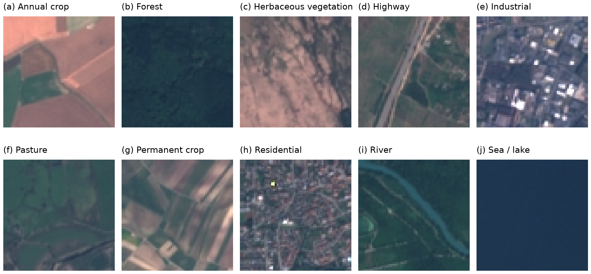

# EuroSAT Representation Benchmark

CS7643 research project comparing frozen CNN and Transformer representations with 1, 5 and 10 labeled images per land-use class. The [proposal](docs/project-proposal.pdf) defines the study; [TODO.md](TODO.md) tracks implementation and experiments for four teammates.



Native RGB support images from EuroSAT (Helber et al., 2019; Copernicus Sentinel-2). [Dataset audit and figure provenance](docs/dataset.md).

## Run in Colab

1. Open the notebook linked below; it already includes the code and saved outputs.
2. Upload `EuroSAT_Representation_Benchmark.ipynb` to Colab and choose a **GPU** runtime.
3. Run all cells and authorize Drive. Start with `MODE = 'smoke'` to check execution.
4. For research runs set `MODE = 'full'`. Each teammate sets `ASSIGNMENT` to their backbone from Parts A–D.

In VS Code, choose **Select Another Kernel → Colab → New Colab Server → GPU → Python 3 (ipykernel)**. The runtime must have an NVIDIA GPU; selecting Python on a TPU server does not change its hardware. The notebook checks the device before downloading data. Colab allocation and account authorization happen in your own account.

Open **[EuroSAT_Representation_Benchmark.ipynb](EuroSAT_Representation_Benchmark.ipynb)** for all notebook work. It contains the actual helper code in ten labeled, readable cells and needs no GitHub credentials when uploaded to Colab. Saved dataset previews are visible before execution, followed by dataset tables, six figures, four labeled implementation parts with TODO checkboxes, and one selected execution cell. The same file works locally in VS Code with `TARGET = 'local'`.

## Local development

Use Python 3.11 and run these commands from the repository root:

```sh
python3.11 -m venv .venv
source .venv/bin/activate
python -m pip install -r requirements/local.txt
python scripts/build_notebook.py
python -m unittest discover -s tests -v
python -m eurosat run --mode smoke
```

Select `.venv` as the VS Code kernel for local work and set notebook `TARGET = 'local'`. Local runs use available CUDA, Apple MPS or CPU. Keep Colab's existing CUDA/PyTorch installation; `requirements/local.txt` is for local setup.

```sh
python -m eurosat explore --output docs/figures
python scripts/execute_notebook.py
python -m eurosat merge outputs/model-a/results.json outputs/model-b/results.json --output outputs/combined
```

## Repository structure

```text
EuroSAT_Representation_Benchmark.ipynb  One notebook: dataset exploration, Parts A–D, experiments
src/eurosat/
  config.py, runtime.py       Presets, checkpoint identities and hardware checks
  data.py, exploration.py     Verified data, splits, audit and figures
  augment.py, models.py       Support transformations and four frozen adapters
  features.py, cache.py       Chunked embeddings and atomic checkpoints
  evaluation.py              Common classifier and paired metrics
  pipeline.py, reporting.py   Execution and compatible teammate export merging
  cli.py                     run / explore / merge commands
scripts/                     Notebook generation and fresh-kernel execution
requirements/local.txt       Local PyTorch pair and editable project installation
tests/                       Data isolation, reproducibility and resume checks
docs/                        Proposal, methodology, figures and team instructions
TODO.md                      Checkoff plan with suggested four-person workstreams
```

The executor saves cell outputs into this same notebook; it does not create another notebook copy. Rebuilding preserves saved outputs when the code is unchanged; changed code starts with measured dataset previews.

Edit reusable behavior in `src/eurosat`, and notebook narrative in `scripts/build_notebook.py`; rebuild and commit the tracked notebook. `dist/`, environments, datasets, caches and raw result exports are ignored; reviewed notebook outputs are retained. CI checks the notebook, runs unit tests and builds the package.

## Study and recovery

The primary study uses all ten classes, deduplicated 60/20/20 support/development/test partitions, frozen ResNet-18, ConvNeXt-Tiny, ViT-B/16 and DINOv2, and the same development-tuned logistic regression. Full mode includes 20 paired trials, ten augmentation/control conditions and three shot budgets: 2,400 classifier results. Smoke scores are execution checks, not research findings.

Colab saves the archive, weights, feature chunks, classifier checkpoints and completed trial records to `MyDrive/ColabNotebooks/cs7643/EuroSATRepresentationBenchmark`. Raw images are extracted to disposable runtime-local storage. Rerunning resumes matching cached work; a restart may need to extract images again. Local caches and Drive caches are separate. Changing relevant settings creates different cache identities; increment `PIPELINE_VERSION` for semantic code changes.

Read [collaboration](docs/collaboration.md) for ownership, branches, shared Drive and merging; [methodology](docs/methodology.md) for protocol and limitations; [original-notebook migration](docs/migration.md) for what was retained or replaced; and [validation](docs/validation.md) for execution evidence.

Existing Drive storage named `EuroSATLowData` is reused automatically to preserve earlier caches. New storage uses `EuroSATRepresentationBenchmark`; set `EUROSAT_STORAGE` to override it.
