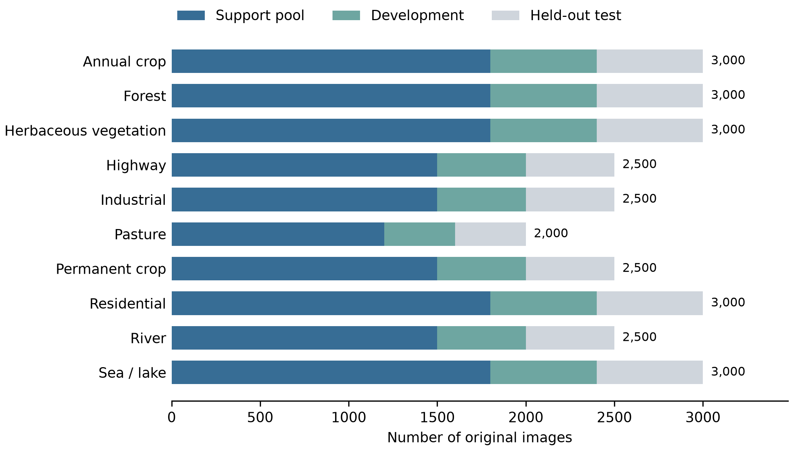
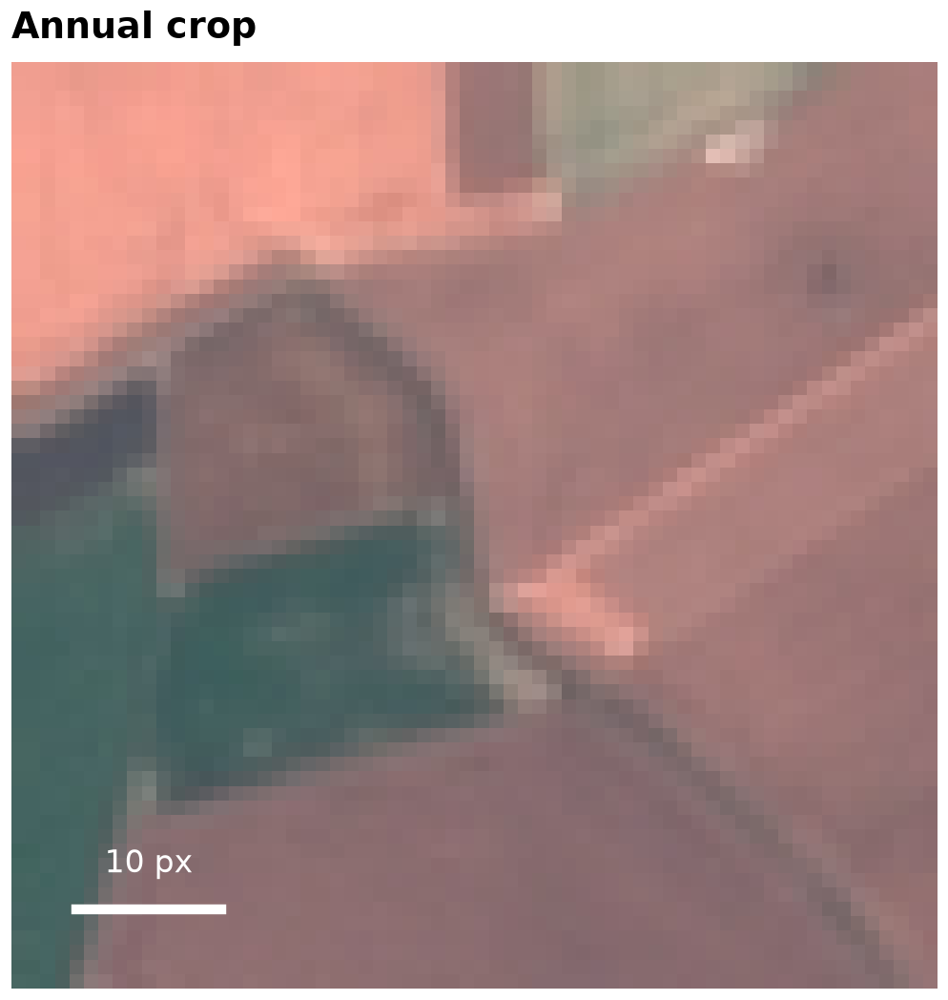

# Dataset exploration

The verified full EuroSAT RGB archive contains **27,000 native 64 × 64 RGB images across ten classes**. This checkout's decoded-pixel audit found **zero exact duplicates**, zero corrupt images and zero image/pixel overlap between partitions. Class sizes range from 2,000 to 3,000 (ratio 1.5). These are measured audit results, not a claim of geographic independence.

The deterministic stratified split retains 16,200 support-pool, 5,400 development and 5,400 held-out test images. The original-shot budget samples from the support pool; it does not train on the entire pool. Full-dataset EDA runs even when later execution is in smoke mode.

The notebook displays six numbered figures: cleaning counts, class distributions, one labeled image, all ten classes, the actual stratified shuffle, and processed augmentation examples. pandas provides tables; seaborn and matplotlib generate plots. Native examples come only from support images, use nearest-neighbor display, and are not enhanced. Augmentation views are explicitly distinguished from native images. Pixel markers are not geographic scale claims.

Reproduce with `python -m eurosat explore --output docs/figures`. PNGs use 300 DPI; PDFs are available alongside them. [Measured profile](figures/dataset_profile.json), [class counts](figures/class_counts.csv) and [example provenance](figures/figure_sources.json) accompany the figures.

Dataset attribution: Patrick Helber, Benjamin Bischke, Andreas Dengel and Damian Borth, “EuroSAT: A Novel Dataset and Deep Learning Benchmark for Land Use and Land Cover Classification,” IEEE JSTARS, 2019. Sentinel-2 imagery: Copernicus. Refer to the [official EuroSAT project](https://github.com/phelber/EuroSAT) for dataset citation and terms.
